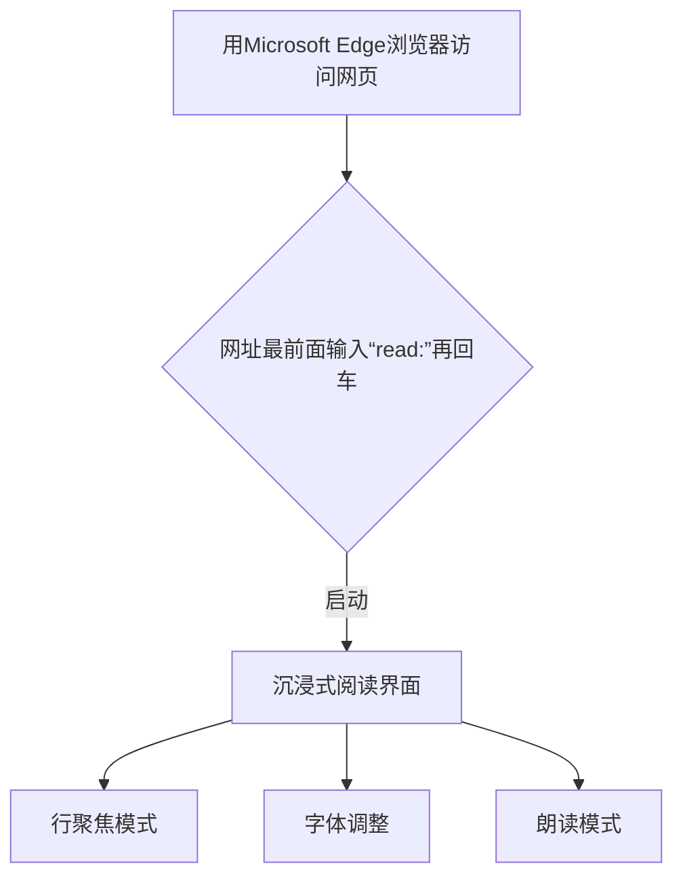

不知道你有没有注意到，当你上网准备处理一件事情的时候，

明明没有买东西的计划，却不小心下单了。

> 打开电脑时，自动跳出一个网页，是你心仪已久的裙子；**点进去**
>
> 打开网页时，看到你喜爱的某某明星穿着超酷的跑步鞋；**点进去**
>
> 打开软件时，收到推送消息：“客官，你好久没来了.....”；**点进去**

我也经常陷入这样的“困境”，包括我身边的人、我的家人，以至于她们每天必做的事情就是去拿快递。

我们的专注力和金钱同时被网络“夺”走，需要化被动为主动，把决策权牢牢抓在自己手上。

为此我一直在找寻，也做过如下的一些改变：

* 首先，有意识地“捂紧口袋”

  当付钱输入密码时，一定要下意识的练习冷静3秒，问自己：“我刚准备干啥来着？是这件事情吗？”

* 其次，多用电脑办公、上网，处理事务

  手机比电脑更容易干扰我们，因为有各种App、小程序、公众号推送信息；还会被短信、电话打扰。
  
  为了更专注地使用电脑上网，避免不必要的消费，我还研究了一个教程，只需一个单词就能开启洁净的网络世界。

这个教程，除了能

- **屏蔽广告** ：自动剥离页面干扰元素

之外，还有两个好处：

- **聚焦阅读** ：更专注的阅读体验
- **增强理解** ：提高理解效率

### Microsoft Edge沉浸式阅读器教程 
1. [安装Microsoft Edge浏览器](https://www.microsoft.com/zh-cn/edge/download?form=MA13FJ)！

   [安装Microsoft Edge浏览器](https://www.microsoft.com/zh-cn/edge/download?form=MA13FJ)！

   [安装Microsoft Edge浏览器](https://www.microsoft.com/zh-cn/edge/download?form=MA13FJ)！

2. 打开**任意网页**,或者复制网址至Microsoft Edge浏览器网址栏  

3. 将光标移至网址栏最前面，输入`read：`，再按“回车”键

4. 见证页面瞬间净化

5. 可以开启“行聚焦”+“朗读”模式

   一次一行，阅读专注；加上“看”和“听”同步进行，多感观吸收，增强理解。（如果眼睛注视太久，可以移开屏幕休息，用听觉接收“信息”）

### 可视化流程 

## 操作提示

* **PDF**格式文件可用Microsoft Edge浏览器打开可开启“朗读”模式。
* 如按以上操作输入"read:"回车，页面无法显示的部分，可能是视频或动画占比多，那就放弃沉浸式阅读设置。
* 此教程基于Windows操作系统。
* 原文此处是操作截图；图片未随文发布，步骤以正文为准。
