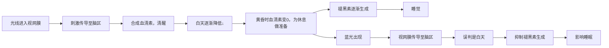

**一句话原理**：光线暗下来，你的褪黑素才会正常生长出来。

**本文脉络**（三层递进）：

1. **技术层 —— 带来什么影响？** 光线如何左右睡眠、专注力与消费冲动
2. **原型层 —— 怎么影响？** 一个 `Win + Ctrl + C` 就能切换的灰度世界，具体怎么开
3. **原理层 —— 为什么？** 光线 → 血清素 / 褪黑素 → 昼夜节律的完整链路

先看一段话。一位脑科学神经科学家写道：

> 科学数据表明，睡眠时间不充足的人
>
> 患上癌症的风险是一般人的6倍，
>
> 患上脑出血的风险是一般人的4倍，
>
> 患上心肌梗死的风险是一般人的3倍，
>
> 患上高血压的风险是一般人的2倍，
>
> 患上糖尿病的风险是一般人的3倍。
>
> 一项针对日本男性的调查显示，
>
> 平时睡眠时间不足6个小时的人，与每天睡7～8个小时的人相比，死亡率要高出2.4倍。
>
> 由此可见，**缩短睡眠时间，无异于缩短寿命**。
>
> 退一万步来说，如果缩短睡眠时间，能够高效率、高质量地工作，我也不多说什么。
>
> 但现实是，晚上熬夜之后，第二天人的专注力会急剧下降，专注时间大幅减少。
>
> 对第二天的工作会产生极大的坏影响，这不是得不偿失吗？缩短寿命、影响专注力。

这组“X 倍风险”的数字在中文网络上流传很广，但**查不到可追溯的原始研究出处**（并非期刊原文数据，更可能是多手转述后的叠加）。作为“睡眠不足很严重”的动机可以，作为论据引用不建议——真要拿数据说话，请直接引原始研究。

睡眠不好，也会影响专注力，所以睡觉是大事。我们平常总不起眼的，往往非常重要，比如对生命来说，空气、水，等等，看似不起眼，如果没有将没命的可能。

只是平时我们不易察觉。

我知道使用电子产品对睡眠不好，所以尽量早起做事，这样一天的事情可以早些结束，只是在如今这个缤彩纷呈的世界，有很多尘世中的“俗”事要去做，一搞搞到23：00后，仍不自知。

对，这还是不刷视频、不看朋友圈的自我约束下。

有时为了更快的推进一些事，坐在电脑前一坐坐半天，当眼睛离开屏幕，像身处另一个世界，有些干涩、眩晕，为此都有点恨现在的科技“催”人老。

为了更好的与科技和谐相处，看了一些文章和书籍，以及平时用墨水屏、看纸质书，

用一键设置，将电脑和手机一键可切换到黑白年代。

这能带来什么好处呢？

1. 缓解眼疲劳，减少蓝光对大脑的刺激，提高睡眠质量和时长。
2. 减少消费，购物网站的颜色都偏刺激大脑消费的颜色。
3. 减少使用时间，刷短视频更没欲望了。
4. 提高专注力，避免被打扰，不注意看不清“小红点”提示。

文献书籍来源：《睡眠修复：解决疲劳困扰的新科学》每八章、十章、第十六章。

《为什么精英都是时间控？》

《手机大脑：让人睡眠好、心情好、脑力好的戒手机指南》

### 3秒进入灰度世界

**Windows 10 / 11 魔法快捷键：**
1. 按下 **Win + S** 召唤“电脑搜索”
2. 搜索“颜色滤镜设置”并打开
3. 打开颜色滤镜的**键盘快捷方式**选项
4. 勾选「使用反转灰度」
5. 立即生效的快捷键：**`Win + Ctrl + C`**（按下即切换灰度世界）

> [注意]
> - 需要先在「设置 > 辅助功能 > 显示与文字大小 > 颜色筛选器」中打开颜色筛选器
> - 若想**手动**切换黑白（而不是跟随日落自动切换），再新建一个快捷指令：动作选「设定颜色筛选器」，开关设为「切换」
> - 两个快捷指令可以并存：一个跟随日落自动切换，一个随时手动切换

（手机端操作示意图：显示快捷指令设置路径和夜览开关位置）

### 背后的科学：蓝光如何劫持你的睡眠

在这里，我也不想使用专业的术语来解释，尽量让每个人都能理解大概的流程来展示光线对睡眠的作功：

影响睡眠质量好坏与长短的原因是褪黑素的生成，你可以理解为褪黑素有2小时生长期。

故：

如果准备22：00睡，那就是在20：00时就不要用电子产品，房间的灯调成很暗。有助于褪黑素早点生成。早点进入真正的睡眠状态。

反过来，如果想白天更有精神，就不要拉窗帘睡觉，因为光线会透过眼皮，可以早一点生成血清素，激活你自然醒。或者早上尽量睁开眼看见光，或者一早去晒太阳，白天清醒程度会更高。

### 现在立刻，马上行动！

那你需要行动的是：

* 提前2小时放下手机，或者把手机放至另一个房间管控自己。
* 可以看纸质书，听书的事情，也就是不用眼睛接触光的事情。

研究表明，2013年的一项关于睡前1小时内设备使用情况的研究也得出了类似的结论：

**一台设备的互动性越强，其使用者就越有可能会陷入入睡困难，或者睡眠效果不佳**。

设置耗时＜1分钟，效益持续数十年。当世界突然安静，你会听见眼睛在说：**“早该这样了。”**

**＞＞ 今日行动：**
右手小指按下 `Win + Ctrl + C` ，左手轻敲iPhone背壳3下——**用黑白结界，夺回睡眠主权！**

如果实在需要使用电子产品工作，我劝你：

* 使用一键切换黑白，加戴防蓝光眼镜。
* 使用电脑工作，可以提高工作效率，缩短时间，早点准备休息。

已有实验研究报道（Chang 等，*PNAS*，2015）：睡前 2 小时使用发光的移动设备，可使**褪黑素分泌起始时间推迟约 1 小时**，且在受控实验条件下测得褪黑素抑制幅度可达 50% 以上（具体数值随屏幕亮度与观看内容差异很大）。

需要说明的是：**“减少 23%”“相当于让内分泌系统退化到青少年水平”这类具体数字，在公开文献中查不到对应出处，属于流传中的二次加工，此处不予采用。**

普通防蓝光模式仅过滤部分蓝光波段，而**灰度模式通过消除所有色彩刺激**，实现三重防护：
1. 降低光谱能量峰值
2. 减少视觉皮层处理负荷
3. 消除彩色内容吸引力

### 💥【原理暴击】为什么灰度是宇宙级护眼法则？

> 你以为夜间模式的“屎黄色”就安全？**大错特错！**

| 攻击方式       | 夜间模式（暖黄） | 灰度模式（黑白）  |
| :------------- | :--------------- | :---------------- |
| **蓝光波段**   | 仅削弱未根除     | **彻底物理删除**  |
| **色彩对比度** | 高刺激持续       | **信息量暴跌90%** |
| **眼球负荷**   | 睫状肌拼命对焦   | **瞳孔自动松弛**  |

**暴击解析：**

1. **蓝光之罪不在“冷”而在“毒”**：蓝光峰值能量是红光的3倍，直接穿透视网膜轰炸生物钟。暖黄调只是安慰剂，**鲜艳色彩中的残余蓝光+高对比信息流，照样榨干你的视觉神经！**
2. **灰度=给眼睛装降噪耳机**：当屏幕只剩明度信息，大脑处理负荷锐减。睫状肌从“百米冲刺”切换到“静坐冥想”，酸胀感原地蒸发！
3. **黑白屏=天然防沉迷结界**：失去色彩刺激的抖音/小红书，吸引力暴跌至报纸水平——**身体比你更懂：该睡了。**

> 这就是认知差：99%人膜拜“暖黄神教”，却不知按下`Win+Ctrl+C`那刻，你已对蓝光发动了降维打击！

------

###  意料之外的认知升级

当你的屏幕变成黑白世界时，发生了一件神奇的事：原本令人沉迷的短视频突然索然无味，花哨的购物图标失去诱惑力。灰度模式不仅是护眼工具，更是一把**注意力滤网**。

李笑来在《财富自由之路》中强调：“注意力＞时间＞金钱”。当我们关闭色彩诱惑：
- 短视频和购物 App 的吸引力明显下降（**个人体验**，无对照实验）
- 对“红点”“彩色促销”的生理性冲动显著减弱（**个人体验**）
- 视觉信息密度下降后，读长文更容易进入状态（**个人体验**）

### 背后的原理

核心是：被动与主动防护

屏幕的真相要是你听过接下来这几句话，你就把我喊停：屏幕会发出蓝光，蓝光影响睡眠，所以你应该保证在至少还有两小时要上床的时候就不要碰屏幕了……把手机带上床更是想都不用想。尽管这其中的逻辑听着非常直接明了，可实际情况却要微妙得多。

很大程度上取决于你在用屏幕干什么。

现在的设备内容被设计好了要连续不断地迫使用户做什么。我们会无休无止地滑动社交媒体的推送，电子游戏的游玩时长可能会达到13个小时以上，甚至电视节目也更具有连续性了—有时候下一集会自动就开始播放了。因此，想要抽离出来就变得更加困难了，也更容易失去时间感以及睡意。而你会注意到的下一件事就是，已经过去好几个小时了，你不仅仅是醒着，而且是太过活跃以至于睡不了觉。

---

## 参考文献与数据可靠性说明

### 可追溯的文献

| 结论 | 来源 | 可靠性 |
|------|------|--------|
| 夜间光照抑制褪黑素、推迟分泌起始时间 | Chang AM, Aeschbach D, Duffy JF. *PNAS* 2015;112(4):1232-7 | ⭐⭐⭐⭐ 同行评议期刊原文 |
| 蓝光峰值能量高于红光 | 常规光度学常识，任何色度学教材均可查 | ⭐⭐⭐⭐ |
| 褪黑素受光抑制、血清素受光促进 | 生理学常识 | ⭐⭐⭐⭐ |

### 书籍（真实存在，可作延伸阅读）

- 《睡眠修复：解决疲劳困扰的新科学》
- 《为什么精英都是时间控？》
- 《手机大脑：让人睡眠好、心情好、脑力好的戒手机指南》
- 《财富自由之路》李笑来 —— “注意力＞时间＞金钱”

### 本文中标为「个人体验」的部分

灰度模式对注意力、消费冲动的具体影响，是**作者自身观察**，未做对照实验，不能当作研究结论。

### 已剔除的流传数据

文中原有的“邮件处理效率提升 40%（斯坦福眼动实验）”“每日多出 53 分钟专注时间（纽约时报调研）”“深夜手机使用时长减少 68%（睡眠医学期刊）”“入睡提前 37 分钟、睡眠质量提升 62%”“睡前 2 小时蓝光使褪黑素减少 23%（哈佛医学院）”等具体数字，**均未找到可追溯的原始出处**，已移除或改标注为待核实。

> 写作原则：**能被验证的数字才配被引用。** 找不到出处的数据，宁可写成“个人体验”，也不冒充研究结论——这是对自己读者负责，也是对自己长期信用的保护。
